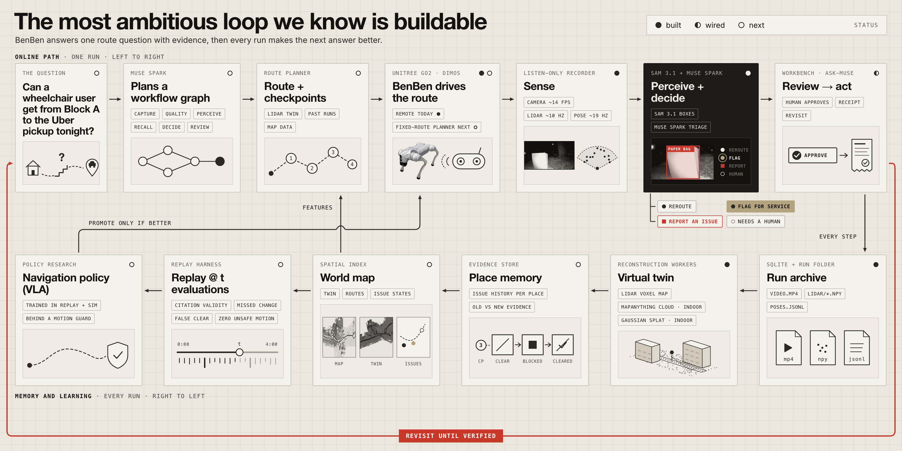

# BenBen

BenBen is a Unitree Go2 robot dog that walks a residential estate's routes and checks them for access barriers. A person drives it with the handheld remote. A Mac records its camera, LiDAR and pose over a listen-only link. Meta's Muse Spark reads each frame and picks one action: **reroute**, **flag for service**, **report an issue** or **needs a human**. SAM 3.1 outlines the obstacle, and the dashboard keeps every finding with its photo and capture time.



## Why

Shivraj, from the demo script:

> I got injured and ended up in a wheelchair. I take public transport, and I realized I had no idea if my route to the bus was even passable.
>
> From my desk I watch people struggle at this exact spot. I've seen people fall here.

Sidewalk-routing apps such as Emerald Path (Hack@Brown 2026) route on city datasets of width, incline and surface. Those datasets can be years old, and they can't show that a cart blocked the ramp this morning. BenBen walks the route and checks it against what is there.

## What happened on Nov 4

Shivraj drove BenBen around the estate after dark for about four minutes. The recorder kept 3,396 video frames, 2,355 LiDAR clouds and 227 timestamped stills. Muse Spark judged 14 of the stills: one reroute (steps with no ramp), two flags for service (a paper bag on the footpath), one reported issue (a raised step at an entrance) and ten for a human. Eight of those ten were too dark for the camera. The LiDAR view covers those stretches. [docs/STATUS.md](docs/STATUS.md) separates what ran from what is wired and what is roadmap.

## Quickstart

The dashboard needs Python 3.10+ and no packages:

```bash
python3 app/server.py
```

Open http://127.0.0.1:8766. The workbench shows one inspection run: action items on the left, the LiDAR map in the middle, clips and ask-Muse on the right. It reads the run folder given by `--run-dir` (default `.artifacts/benben-runs/20261105T002653Z`, the Nov 4 run). Recordings are not in Git, so on a fresh clone the workbench says the run is missing and asks for `--run-dir`.

To use Muse Spark and SAM 3.1, start it through the key loader instead. The first run asks for your Meta API key at a hidden macOS Keychain prompt:

```bash
bash setup/run_app.sh
```

To load a recorded run into a fresh workspace:

```bash
python3 app/import_capture.py .artifacts/benben-runs/<run> --data-dir .artifacts/demo
bash setup/run_app.sh --data-dir .artifacts/demo
```

Recording from the robot is in [setup/README.md](setup/README.md). Recordings stay out of Git.

Checks:

```bash
python3 -m unittest discover -s app -p 'test_*.py'
python3 app/verdict_eval.py --self-test
```

## What's here

| Folder | Role |
|---|---|
| `app/` | Dashboard and evidence store (stdlib HTTP server, SQLite), Meta model calls, importers, tests |
| `capture/` | Listen-only recorder, LiDAR split-screen renderer, batch Muse triage, DimOS recording exporter |
| `setup/` | Key loader and Mac setup |
| `autonomy/` | Roadmap from a person driving to BenBen walking the route itself. **Not in the demo.** |
| `docs/` | [Architecture](docs/ARCHITECTURE.md), [2-minute demo](docs/DEMO.md), [status](docs/STATUS.md) |

## Meta models

| Model | Used for | State |
|---|---|---|
| Muse Spark, `muse-spark-1.3` | Triage of each frame; questions about the evidence in the dashboard | Ran live on 14 frames from the Nov 4 run |
| SAM 3.1, `sam-3.1` | Box around a named obstacle ("stairs", "paper bag") | Ran live on 6 frames from the same run |
| Voice Transcribe, `muse-voice-transcribe-1.0` | Spoken questions in the dashboard | Wired; tested with a stub only |

If the Meta API is unavailable, `META_PROVIDER=baseten` routes Muse calls to Muse Spark Open on Baseten. That path is untested.

## Credits

- [DimOS](https://github.com/dimensionalOS/dimos) (Apache-2.0): our capture environment came from its install, `capture/export_run.py` reads its recordings, and its planner and patrol modules are what `autonomy/` builds on.
- [unitree_webrtc_connect](https://github.com/legion1581/unitree_webrtc_connect) (MIT): the WebRTC client the recorder listens through.
- Emerald Path (Hack@Brown 2026): prior art for accessible routing. Great routing apps exist. They're only as good as their map.
- Inter and Instrument Serif fonts, under the SIL Open Font License.

MIT licensed; see [LICENSE](LICENSE).
