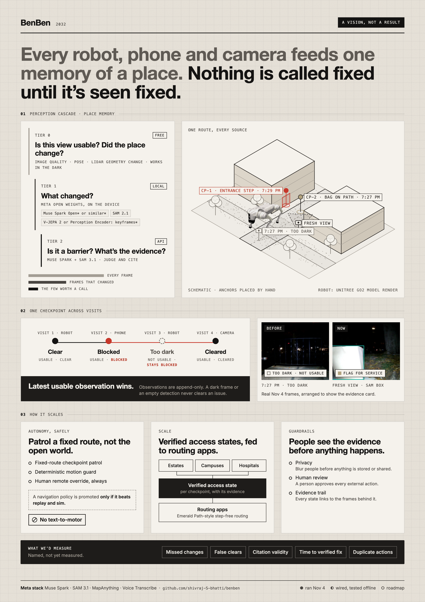

# BenBen

**BenBen keeps the map true.** It is a robot dog that walks a neighbourhood's step-free routes, works out what blocks them, and won't call a route clear until it has seen it clear.

## Why we're building it

> I got injured and ended up in a wheelchair. I take public transport, and I realized I had no idea if my route to the bus was even passable.
>
> From my desk I watch people struggle at this exact spot. I've seen people fall here.
>
> Shivraj

Before one trip to the train station, Shivraj had to ask an Uber driver to check the route for him.

Accessible routing already exists. Apps such as Emerald Path (Hack@Brown 2026) plan step-free routes from city datasets of sidewalk width, incline and surface. A survey team collects those datasets once, and they can be years old. They can't know that a delivery cart blocked the ramp this morning or that wet leaves now cover the kerb. Today a property manager learns about a barrier from the person who couldn't get past it.

What's missing is fresh evidence about the route, kept for each place over time. A patrol robot can collect it. The hard part is making its conclusions trustworthy.

## What BenBen does

BenBen is defined by six behaviours ([one-page version](docs/onepagers/today.png)):

1. **Notices change.** Geometry decides when to look, and vision decides what it is. A LiDAR height change at a checkpoint triggers a camera look, and the LiDAR works in the dark.
2. **Judges with evidence.** Muse Spark picks one action: reroute, flag for service, report an issue, or needs a human. SAM 3.1 outlines the object, and every judgement cites the frame it came from.
3. **Won't clear in the dark.** The latest *usable* observation wins. A dark frame or an empty detection never closes an issue.
4. **Asks one question.** When the model can't decide, a person gets the outlined frame and one question ("Is the bag on the path or beside it?"), answered with a tap.
5. **Goes back to look.** An issue stays open until a fresh view shows it cleared. A notification is not a fix.
6. **Plans its next look.** A reasoner chooses where to go next from open issues, stale checkpoints and new reports.

## How it works

The diagram is one loop that runs in two directions.

**One run, left to right.** A route question, such as "Can a wheelchair user get from Block A to the pickup tonight?", goes to the reasoner, which plans a patrol over route checkpoints. An action model walks each leg behind a deterministic motion guard, so model text never reaches the motors. The robot streams camera, LiDAR and pose. A cheap gate passes a frame on only when the view is usable and the geometry has changed. The frames that pass go to SAM 3.1 and Muse Spark, which outline the obstacle and choose an action. A person approves anything that leaves the system.

**Every run, right to left.** Each run is archived as raw video, LiDAR clouds and poses. Reconstruction workers rebuild the place as a virtual twin: LiDAR geometry, a MapAnything metric cloud, and a Gaussian splat for appearance. Place memory keys every observation to a route checkpoint. "Is it still blocked?" then becomes a comparison of the last two usable views at that checkpoint, with no object re-identification needed. The world map carries issue states out to routing apps. Replay grades every new model or policy on recorded runs. A new navigation policy is promoted only if it beats the current one in replay and simulation.

Three rules keep the system honest:

- Observations are append-only. An issue's state is recomputed from them on every read and never stored.
- Models propose and a deterministic runner executes. A person approves every external action.
- Each question to Muse gets bounded context: the previous usable observation, the latest one, and the issue's history. A month of patrols costs the same context as one walk.

The perception cascade spends model calls only where they matter:

| Tier | What runs | The question it answers |
|---|---|---|
| 0, free | Blur and brightness checks, pose, LiDAR height-map difference | Is this view usable? Did the place change? |
| 1, local | Meta open weights on the device: SAM 2.1, and a video encoder such as V-JEPA 2 to pick scene-change keyframes | What changed? |
| 2, API | Muse Spark and SAM 3.1 | Is it a barrier, and what's the evidence? |

## What the first outing taught us

We drove an early version around an estate after dark. Muse judged 14 frames, and 8 came back "too dark to tell", while the LiDAR mapped the same stretches cleanly. Three behaviours came from that night:

- **Notices change** exists because darkness defeats the camera but not the LiDAR.
- **Asks one question** replaced "needs a human", the most common verdict and a dead end.
- **Won't clear in the dark** exists because an empty detection never says the path is clear.

## Where this goes: 2032

Every robot, phone and camera feeds one memory of a place, and nothing is called fixed until it's seen fixed. Estates, campuses and hospitals publish a verified access state for each checkpoint, with the evidence behind it, and routing apps read those states. Patrol moves from fixed routes to the open world. The reasoner plans live from the twin and its place memory, and a navigation policy walks the robot under the motion guard.

## What's next

1. Build the tier-0 gate and checkpoint-keyed place memory.
2. Prove revisit and verification on a staged daylight route that goes clear, then blocked, then cleared.
3. Add one-question review to the workbench.
4. Run planned patrol on a real route with the motion guard.
5. Publish verified states as a feed that routing apps can read.

We'll measure missed changes, false clears, citation validity, time to a verified fix, and duplicate actions.

## In this repo

- [`docs/turbo/SPEC.md`](docs/turbo/SPEC.md): the full spec, covering the loop, data contracts, failure modes and build phases.
- [`setup/bootstrap.sh`](setup/bootstrap.sh): one command for dependencies and models (`check`, `app`, `capture`, `twin`, `splat`, `models`); details in [`docs/turbo/SETUP.md`](docs/turbo/SETUP.md).
- [`docs/turbo/assets/benben-loop-v2.png`](docs/turbo/assets/benben-loop-v2.png): the same loop, marked with what is built, wired and next.

## Credits

- Built with Meta's Muse Spark, SAM 3.1 and MapAnything, on a Unitree Go2.
- [DimOS](https://github.com/dimensionalOS/dimos) (Apache-2.0) for Go2 mapping and planning modules, and [unitree_webrtc_connect](https://github.com/legion1581/unitree_webrtc_connect) (MIT) for the robot link.
- The Go2 render uses Unitree's model from [MuJoCo Menagerie](https://github.com/google-deepmind/mujoco_menagerie) (BSD-3).
- Emerald Path (Hack@Brown 2026), as prior art for accessible routing.

MIT licensed; see [LICENSE](LICENSE).
