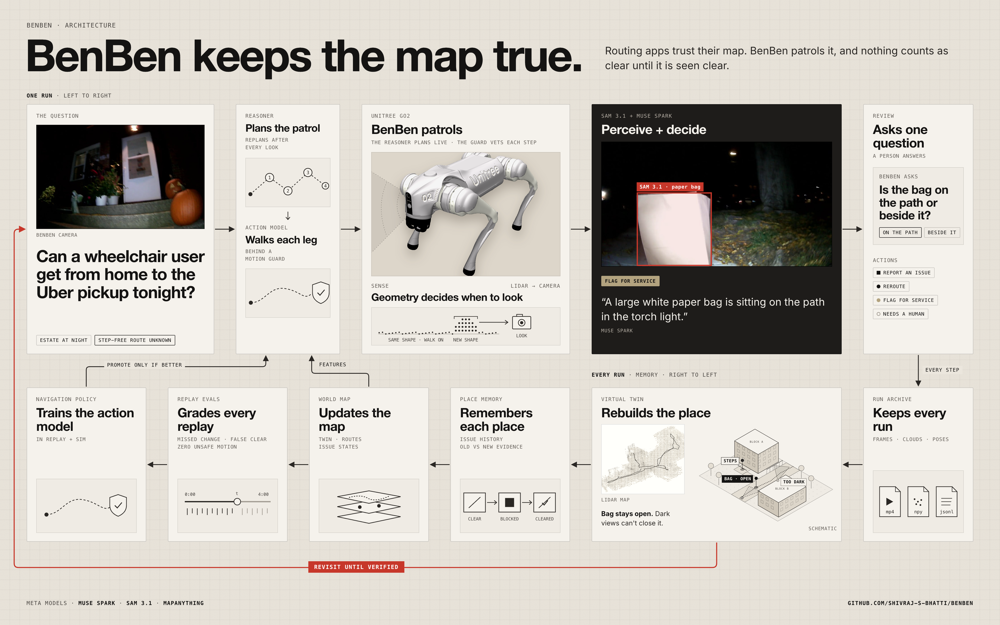
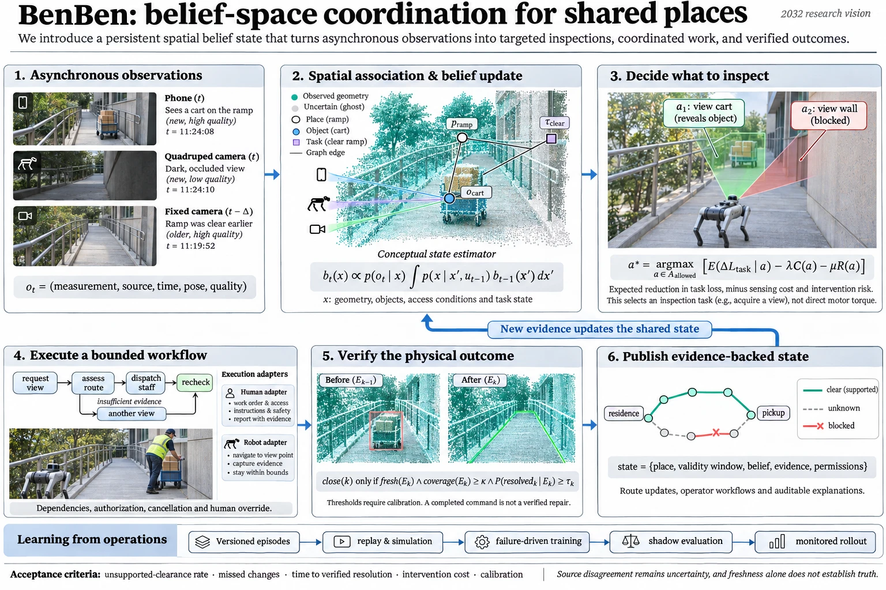
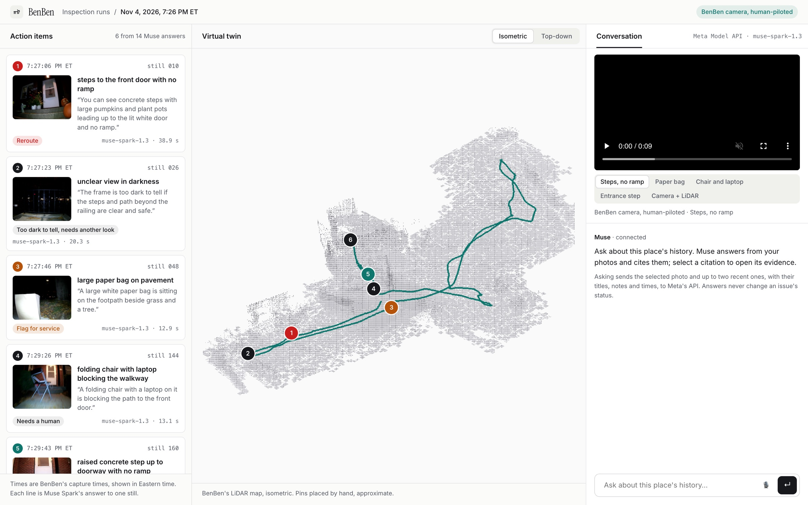

# BenBen

**The friendly neighbourhood robot dog.** BenBen imagines a new era of real-time diagnostic monitoring: reasoning about the state of the world with a spatial and temporal model of it, and how that state will shape over time.

## Why

You only understand how miraculous some things are once you lose them.

When I was wheelchair-bound for a short while and needed public transit, I realised I had no clue whether the path I used to walk so easily was accessible. I asked Maps. It told me about hills and stairs, and nothing about whether my wheelchair would get stuck, or whether I'd have to jump curbs or struggle to climb them.

New York got curb ramps on a schedule because disability groups sued: a [2019 settlement](https://www.cidny.org/wp-content/uploads/2019/07/225_Mot_for_Final_Approval_Accessible.pdf) covers about 162,000 corners and runs into the 2030s. Volunteers with [Project Sidewalk](https://projectsidewalk.org) map sidewalks across dozens of cities. In the suburbs, where [even open map data misses most sidewalks](https://www.cdc.gov/Pcd/issues/2026/26_0255.htm), I literally had to call an Uber driver to go look for me.

Accessible routing has come a long way. This is an experiment to see how much further we can take it. What if…

- **you're not the median**, and could send a scout ahead of a perilous trip?
- **you look after an estate of 300 homes**, and need to triage what needs fixing first?
- **you just cleared the ice on your campus**, but sneaky black ice still waits in a few spots?

That's the problem I decomposed into a robot dog: video and LiDAR reasoning, memory, and agents driving the autonomy, in an infinitely variable world where no two situations are the same. It's also how I'm levelling up in perception, planning and control, and testing how the jump in agents and memory carries over to robots and cobots.

## What BenBen does

1. **Notices change.** LiDAR says something moved; the camera says what it is. Works in the dark.
2. **Judges with receipts.** One action (reroute, flag for service, report, or ask a human), with the object outlined and the frame cited.
3. **Won't clear in the dark.** The latest *usable* look wins.
4. **Asks one question.** "Is the bag on the path or beside it?" One tap.
5. **Goes back to look.** Nothing is fixed until it's seen fixed.
6. **Plans its next look.** Stale and uncertain spots first.

## How it works

**One run, left to right.** A reasoner (Muse Spark) plans the patrol. An action model walks it behind a motion guard, so model text never touches the motors. A cheap gate lets through only usable frames where the geometry changed. SAM 3.1 outlines the obstacle, Muse picks the action, and a person approves anything that leaves the system.

**Every run, right to left.** The run is archived, then rebuilt into a twin (LiDAR, MapAnything, Gaussian splats). Memory is keyed to route checkpoints, so "is it still blocked?" is just the last two usable looks at one spot. Replay grades every new model, and a new policy ships only if it beats the old one.

| Tier | Runs | Answers |
|---|---|---|
| 0, free | blur, brightness, pose, LiDAR change | Is this look usable? Did anything change? |
| 1, on device | SAM 2.1, a video encoder for keyframes | What changed? |
| 2, API | Muse Spark + SAM 3.1 | Is it a barrier? What's the evidence? |

### The formal version

Every phone, robot and camera adds an observation. A Bayes filter folds it into a belief about the place. BenBen picks the look with the biggest expected payoff for its cost and risk, and closes an issue only when fresh evidence says so. A finished work order is not a verified repair.

### The app today

Action items on the left, each with Muse's verdict and the frame behind it. The LiDAR twin in the middle. Clips and ask-Muse on the right.

## Isn't this just a digital twin?

Not quite. A twin [mirrors a place](https://www.frontiersin.org/articles/10.3389/friot.2023.1108777). BenBen keeps *beliefs* about it, with evidence and an age. It chooses what to look at next, and it models how places change: ice refreezes, leaves pile up, carts get parked at 8 AM. That makes it closer to a [world model](https://arxiv.org/abs/2508.09561), with a twin as its canvas.

## Standing on shoulders

- **Memory:** [ReMEmbR](https://arxiv.org/abs/2409.13682) tags robot observations with time and place. BenBen keys them to checkpoints.
- **Where to look:** next-best-view planners like [FisherRF](https://jiangwenpl.github.io/FisherRF).
- **Thinker plus doer:** [Gemini Robotics-ER 1.5](https://deepmind.google/blog/gemini-robotics-15-brings-ai-agents-into-the-physical-world/) and [Figure's Helix](https://www.figure.ai/news/helix) split planning from control the same way.
- **Robots that inspect:** [ANYmal patrols Equinor's Northern Lights site](https://www.anybotics.com/news/equinor-deploys-anymal-at-northern-lights-ccs-facility/), and [Daxbot robots audited about 950 miles of Irvine's sidewalks](https://www.businesswire.com/news/home/20250826137573/en). BenBen asks a smaller, daily question: is this route passable *right now*?
- **Accessible routing:** [Emerald Path](https://devpost.com/software/elevator-path) (Hack@Brown 2026) routes around steep, narrow or rough Boston sidewalks from city data. BenBen walks the route to check it.

## First night out

We drove an early BenBen around an estate after dark. Muse called 8 of 14 frames "too dark to tell", while the LiDAR mapped every stretch. Three of the behaviours above came from that night.

## Next

- Tier-0 gate and checkpoint memory
- A staged clear → blocked → cleared route, to prove revisit and verify
- One-question review in the app
- Planned patrol on a real route, behind the motion guard
- A feed of verified states that routing apps can read

Scorecard: missed changes, false clears, citation validity, time to a verified fix, duplicate actions.

## In this repo

- [`docs/turbo/SPEC.md`](docs/turbo/SPEC.md): the full spec
- [`setup/bootstrap.sh`](setup/bootstrap.sh): one command for dependencies and models ([setup notes](docs/turbo/SETUP.md))
- [`docs/turbo/assets/benben-loop-v2.png`](docs/turbo/assets/benben-loop-v2.png): the loop, marked built, wired and next

Built with Meta's Muse Spark, SAM 3.1 and MapAnything on a Unitree Go2, with [DimOS](https://github.com/dimensionalOS/dimos) and [unitree_webrtc_connect](https://github.com/legion1581/unitree_webrtc_connect). The Go2 render uses Unitree's model from [MuJoCo Menagerie](https://github.com/google-deepmind/mujoco_menagerie). MIT licensed.
