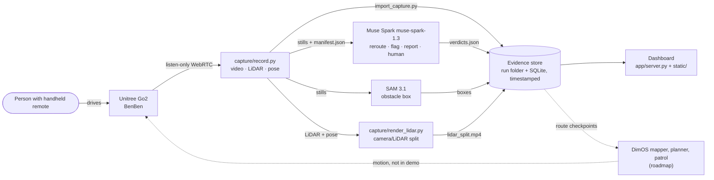

# Architecture

| Stage | File | Notes |
|---|---|---|
| Record | `capture/record.py` | Subscribes to camera, LiDAR and pose. Sends no motor, mode or stand commands. Writes one folder per run. |
| Judge | `capture/beat_verdicts.py`, `app/copilot.py` | One Muse Spark call per still, strict JSON schema, one action per frame. SAM 3.1 boxes go through `/api/segment`. |
| Keep evidence | `app/import_capture.py`, `app/server.py` | The run folder keeps the raw recording and Muse's `verdicts.json`. Each imported still becomes a dashboard observation with its recorder timestamp and SHA-256. Issues are separate records; only a person resolves one. |
| Show | `app/static/` | Localhost only. Model answers must cite photos that were actually sent, or the server rejects them. |
| Act (roadmap) | `autonomy/` | Dashed in the diagram. See [autonomy/README.md](../autonomy/README.md). |

All recordings, workspaces and keys live under the ignored `.artifacts/` folder.
