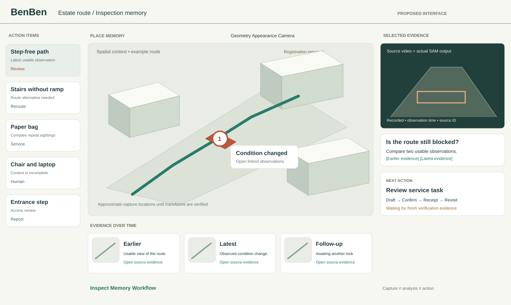
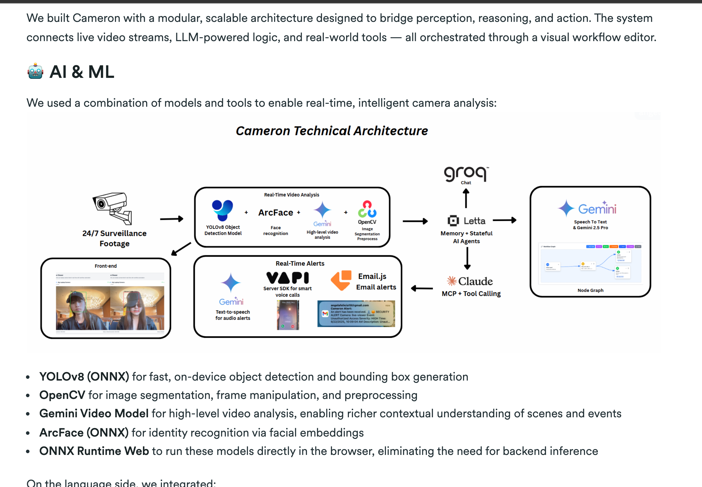
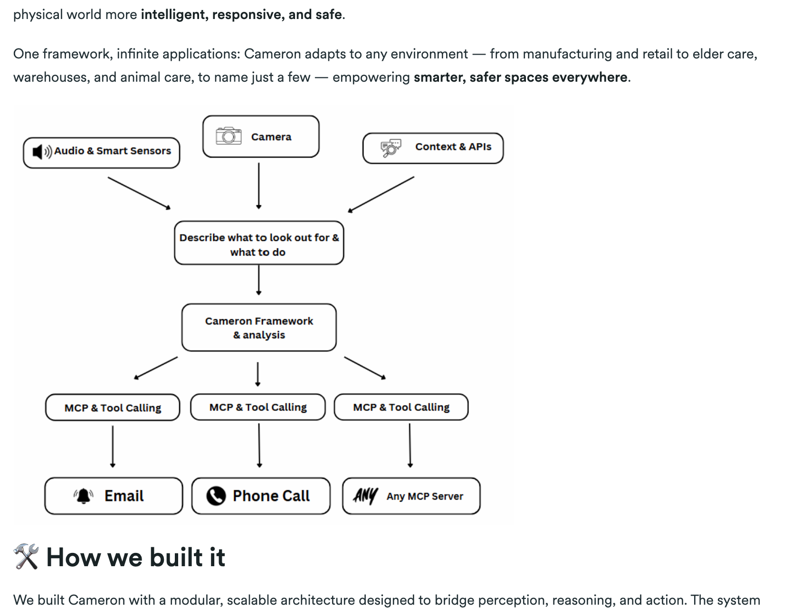
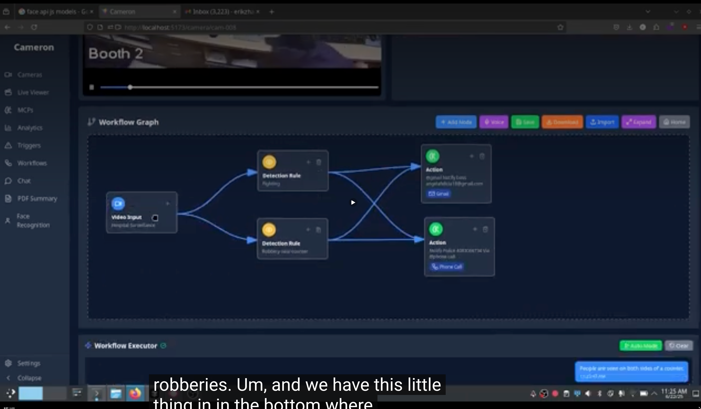
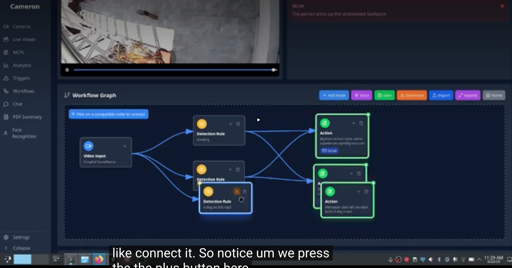
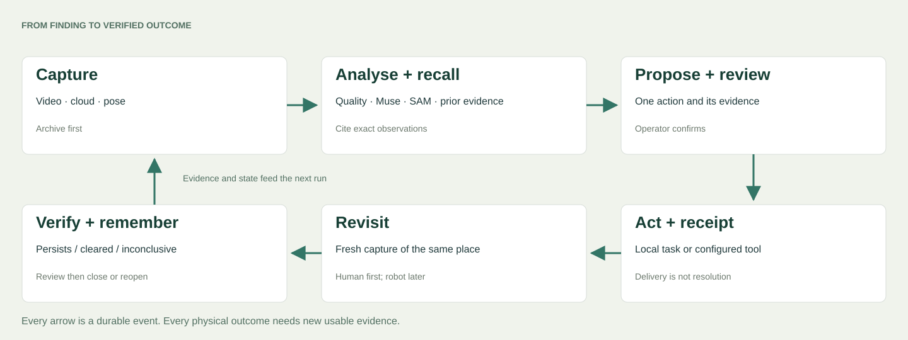

# BenBen: a place that remembers and follows through

**Ambitious branch specification · November 4, 2026 · for Astra and Claude**

Build one product around one question: **“Is the step-free route still blocked?”** BenBen captures the place, remembers its condition, proposes a response, and checks what happened next. The robot is a mobile sensing endpoint within that product. Phone capture, fixed cameras and human reports can contribute to the same evidence history.

This document specifies the future branch. The baseline is `benben` commit `edf5619`; its [status ledger](../STATUS.md) establishes what already ran. Keep that distinction in the implementation and demo. Astra and Claude should decide the choices in §12, then implement the acceptance gates in order.

## 1. The experience we want

A resident or operator opens a remembered route. The large viewport shows its spatial context. Selecting an issue focuses the relevant camera clip, observation time and location. The assistant answers with the previous and latest usable observations; clicking a citation seeks the video and highlights the corresponding evidence. A workflow shows what BenBen checked, what it recommends, who acted, and whether a later visit verified the result.

**The defining demonstration:** a path is clear in an earlier capture and blocked in a later one. BenBen retrieves both, points to the change, drafts a task, waits for the operator to confirm it, then requests another look. Only a usable follow-up can support a clearance decision. A successful notification is an intermediate event; the physical outcome closes the loop.

The existing four clips illustrate different responses: stairs without a ramp suggest a structural route problem; a paper bag is a possible service task; a chair/laptop requires contextual review; an entrance step needs an access review. Do not infer ownership, hazard severity or exact clearance from object labels alone.

## 2. Start from the working system

| Already present at the baseline | Preserve and extend |
|---|---|
| Human-piloted Go2; camera, decoded LiDAR and pose recording | Capture adapters produce the same observation envelope for replay and new recordings. |
| Muse Spark triage on real route frames; SAM 3.1 returns obstacle boxes | Keep outputs tied to their input observation, provider/model and prompt version. Boxes are not pixel masks. |
| Run-based workbench with actions left, LiDAR centre, clips and conversation right | Evolve this layout; don't introduce a second competing home screen. |
| SQLite evidence store; importers; citation validation | Add temporal associations and workflow events without discarding original evidence. |
| Read-only capture; dry-run navigation skeleton | Continue replay-first development. Nothing in this spec authorizes a live robot connection. |

The baseline records 14 Muse-triaged stills and 6 stills used for live SAM requests. Its dashboard photo Q&A, voice transcription and Baseten fallback have distinct validation states in `docs/STATUS.md`. A small number of live API calls is not an end-to-end autonomous inspection result.

**Not yet established:** a registered photoreal twin, calibrated camera-to-LiDAR projection, persistent object identity across runs, automated follow-up verification, working navigation/VLA control, or a production workflow engine. Night footage also produced “too dark to judge” answers. Missing visual evidence must remain visible even when LiDAR geometry is available.

## 3. One workbench, three modes



*Proposed layout, drawn for this spec. Its scene and example states are illustrative, not a screenshot of implemented features.*

| Surface | Behaviour |
|---|---|
| Header | Place, capture/run, recording time and current operating mode. Recorded playback must never look like a live sensor connection. |
| Left rail | Group persistent issues by place and status. Each item shows last usable observation and age, suggested action and review state. Distinguish one issue seen repeatedly from multiple new issues. |
| Main viewport | Toggle camera, geometry and appearance layers in one place. Selecting evidence focuses its viewpoint when calibration supports it. Otherwise show the frame beside the scene and state that registration is pending. |
| Bottom evidence strip | Earlier → latest → follow-up. Preserve time gaps, missing coverage and capture quality. A scrubber chooses the active observation, not an arbitrary animation time. |
| Right inspector | Selected video and SAM overlay, cited answer, action draft, reviewer decision and execution receipt. Collapse conversation when inspecting a task. |
| Workflow mode | Reuse the viewport for a graph and execution trace. Keep the issue and evidence selection intact while switching modes. |
| Memory mode | Place history, object/issue associations, changed conditions and uncertainty. Every summary opens its source observations. |

Use the current warm light workbench as the default. Teal indicates selection/progress, amber a pending review, red a verified problem state; text and icons carry meaning as well as colour. Prioritize visible video over decorative UI. Dark mode is a variant, not a second component system. Use existing fonts, keyboard-accessible controls, reduced-motion support and readable captions. At narrow widths, stack evidence and inspector; offer a list equivalent for the graph.

**Motion:** real frame → matching twin viewpoint → pull back → focus issue → reveal earlier/current evidence. Prefer a cut or short camera interpolation over a long model orbit. Interruptible transitions must not move the selected observation silently.

## 4. Cameron: borrow the workflow, verify the infrastructure

The exact linked repo is [ezpedersen/smartcam](https://github.com/ezpedersen/smartcam), found through [Cameron's Devpost submission](https://devpost.com/software/cameron-9biv60). It returns public 404 as checked November 4; private versus deleted is unknown. No accessible source checkout, immutable SHA or license was found. The [six-minute demo](https://www.youtube.com/watch?v=V6f42XoBFE0) remains linked. This is a **Berkeley 2025** reference.

The creators describe JSON graphs, import/export, natural-language graph generation, browser workers, LocalStorage configuration, Gemini, Letta/Groq and MCP-based tool actions. Those are author-reported components. Without source, we cannot verify durable execution, retry behaviour, memory persistence or permissions. The documented workflow reaches alerts; it does not establish later-observation verification of a physical outcome. Borrow its workflow grammar now; source-level reuse is blocked until code and terms are accessible.

### What your screenshots contribute



*Supplied reference: a perception layer, memory/agent layer, visual graph and alert adapters. This is the creators' architecture illustration, not independent verification that every component runs together.*



*Borrow the composition: multiple inputs → an explicit condition → a response. BenBen adds a subsequent observation and verification result.*



*Borrow editable nodes, named connectors, saved graphs and an adjacent execution trace. Keep most inspection work in the ordinary workbench; graph editing is an advanced view.*



*Borrow visible node states. For BenBen, distinguish “tool returned successfully” from “condition on the route is fixed.” These supplied screenshots show an alert flow; they do not establish physical outcome verification.*

**Our engineering judgement:** drawing a graph and firing a tool is straightforward. Reliable execution across retries, restarts, missing observations and delayed physical outcomes is the substantial work. Adopt the interaction pattern first. Reuse source only after inspecting an accessible version and its license. Facial recognition and identity surveillance are not needed for this route-inspection product.

## 5. The loop and its runtime



The graph is a versioned program with typed ports. The backend executes the saved graph; the browser only edits and displays it. A deterministic runner owns scheduling, conditions and side effects. A model can propose a condition or action but cannot silently alter an active graph or execute arbitrary code.

| Node | Inputs → output | Completion and failure |
|---|---|---|
| Capture | Recorded/live source → immutable observation | Archive bytes and timestamps first. Missing streams produce explicit availability, not synthesized frames. |
| Quality gate | Observation → usable / needs another look | Blur, darkness, stale data or unknown registration can stop a claim. Retain the rejected evidence. |
| Perceive | Observation + target vocabulary → detections, boxes/masks | Validate coordinates against the decoded frame size. Empty results are a result, not evidence of clearance. |
| Recall | Place + time + condition → cited prior evidence | Retrieve old and new independently. No earlier visit means no change claim. |
| Compare | Comparable observations → change hypothesis | Distinguish object change, camera movement, poor visibility and uncertain association. |
| Decide | Evidence + route policy → proposal | Use structured outputs. “Needs human” is a supported terminal analysis result. |
| Review | Proposal + evidence → approve / reject / edit | Persist reviewer, exact proposed action, graph version and expiry. |
| Act | Approved proposal → attempt + receipt | Allowlisted tools only. Durable idempotency key, bounded retries and explicit ambiguous outcome. |
| Revisit | Issue + checkpoint → inspection task | Human capture is the first implementation. Robot reinspection is a later adapter. |
| Verify | Follow-up evidence + original condition → persists / cleared candidate / inconclusive | New source evidence is required. Reviewer confirms resolution initially; do not resolve on a model assertion alone. |

Example saved workflow:

```text
Capture → Quality → Perceive → Recall → Compare → Decide → Review
                                                           │
                                                           ▼
                   Persist memory ← Verify ← Revisit ← Create task
                                        │
                              inconclusive → Needs human
```

This feedback is scheduled through durable events, not an unbounded graph cycle. Initially accept an acyclic analysis graph plus explicit delayed revisit edges. Validate graph types, required fields, reachable nodes and allowed capabilities before activation.

**Node states:** queued, running, waiting_for_review, waiting_for_evidence, succeeded, failed, skipped, cancelled. Store attempt numbers, lease owner/expiry, input hashes, output references, provider request IDs, latency and retry reason. On restart, reclaim expired leases; don't replay completed external actions. A timeout after dispatch is “outcome unknown,” not an automatic permission to dispatch again. Retry only safely repeatable operations or tools that honour the same idempotency key; otherwise reconcile the receipt or ask the operator.

**Policy controls:** duplicate suppression per place/condition, cooldowns, maximum attempts, per-run inference budgets, task expiry and source freshness. No direct email, phone call or physical motion during replay. Replay can produce action previews; an explicit live activation is a separate control.

## 6. Spatial memory, geometry and appearance

Maintain separate layers with explicit transforms and provenance:

1. **Sensor archive:** continuous camera, per-frame timestamps, decoded cloud packets and source headers, pose stream, calibration and availability. Keep receipt time distinct from source time; record clock offset/uncertainty where measurable.
2. **Geometry:** raw point clouds, registered clouds/mesh, pose graph, traversability representation. A raw source cloud is not automatically a world map. Preserve units, axis convention, frame IDs and registration residuals.
3. **Appearance:** Gaussian splat or textured reconstruction for recognizable navigation and viewpoint replay. A convincing splat does not establish collision geometry or route clearance.
4. **Semantics:** places, object candidates, persistent issues, observations, hypotheses and human-confirmed state changes. Preserve uncertain associations and allow correction/splitting of a wrongly merged issue.

**MapAnything / VGGT path.** Treat [MapAnything](https://github.com/facebookresearch/map-anything) and [VGGT](https://github.com/facebookresearch/vggt) as optional reconstruction workers behind one artifact contract. Candidate jobs select well-spaced, sharp overlapping frames, preserve originals and intrinsics, and record model revision, settings and output transforms. Establish scale, alignment and calibration before placing findings into metric space. Check the selected weights' terms separately from code licensing. Do not promise that dark route footage or an 8 GB laptop will succeed.

**Gaussian path.** Start with an existing captured indoor scene or a separate daylight phone walkthrough. A worker may train with [gsplat](https://github.com/nerfstudio-project/gsplat) on a suitable GPU and export a viewer-compatible artifact. Decode/view a tiny artifact before starting a full training run. Splat files, mesh and registered cloud all implement the same scene adapter; the main product must remain usable when a worker fails.

**SLAM path.** DimOS mapping/patrol remains a separate candidate integration. Verify the installed version and recorded coordinate conventions against its replay before building on it. Use a fixed-route checkpoint planner, not arbitrary exploration, for the route story. A photo reconstruction worker is not a replacement for online localization.

**Projection rule.** A SAM box/mask is in image pixels. To anchor it in 3D requires camera intrinsics, camera-to-sensor extrinsics, timestamps and an accepted pose/transform. Until then, attach the finding to its image and approximate capture location, with no invented point-level precision. Current hand-placed isometric pins remain explicitly approximate.

**Memory compression.** Compact descriptions and index embeddings for retrieval; keep raw images, timestamps, hashes and observation IDs immutable. A generated summary never replaces its sources. A natural-language query should retrieve relevant places and periods, then select evidence with explicit uncertainty. An old “clear” observation cannot override a newer obstruction.

## 7. Data contracts and backend seams

Extend the existing Python service and SQLite store first. Keep providers, capture, reconstruction, tools and robot control behind adapters. Move to a different web framework only when a concrete streaming/concurrency limitation requires it. One durable local worker and an outbox are sufficient for the first full loop; Redis, Letta and an agent framework are options, not prerequisites.

| Entity | Required fields |
|---|---|
| Observation | `id`, `run_id`, `source_id`, `captured_at`, `received_at`, clock metadata, media hash/path, frame index/PTS, pose reference, quality, availability |
| SceneArtifact | `id`, `type`, asset hash/path, source observation IDs, units/frame, transform version, calibration reference, job/model version, processing state |
| Finding | `id`, observation IDs, target class, box/mask reference, coordinate space, model output, rationale summary, confidence/quality signals |
| Place / Issue | Stable ID, route/checkpoint associations, supporting observations, state-event history, last usable evidence time, association confidence |
| WorkflowVersion | Immutable graph, node contracts, capability policy, prompt/model revisions, creator and activation time |
| WorkflowRun / NodeAttempt | Graph version, source event, node states, inputs/outputs, leases, attempts, errors and timings |
| ActionAttempt | Issue/proposal, reviewer decision, adapter, payload hash, idempotency key, dispatch state, external receipt and reconciliation status |
| Verification | Original condition, follow-up observations, comparison result, reviewer decision, next revisit time |

Add indexes around `(place_id, captured_at)`, workflow run/node state and unique idempotency keys. Use database transactions for state changes and outbox creation. Keep raw media in run/artifact folders, not SQLite blobs or Git. Export a portable run manifest plus graph, model outputs and trace; exclude credentials.

Proposed endpoints, added alongside existing `/api/state`, `/api/copilot`, `/api/segment` and issue routes:

```text
GET  /api/places/:id/history?before=&after=
GET  /api/evidence/:id                   # media, provenance, associations
POST /api/workflows                     # validate and save a new graph version
POST /api/workflows/:id/runs             # recorded evidence by default
GET  /api/workflow-runs/:id/events        # cursor-based trace; SSE optional
POST /api/proposals/:id/review           # exact action approval/rejection
POST /api/issues/:id/revisit             # request additional evidence
POST /api/verifications/:id/review       # human-confirmed outcome
POST /api/reconstructions                # enqueue; never train in request handler
```

All POST requests need validated schemas, source/workspace checks and bounded media sizes. Keep API keys server-side. Do not expose a general-purpose shell/MCP executor to a model. If multi-user remote access becomes real scope, add authentication, workspace isolation and explicit capability grants before exposing the local service.

## 8. Models, voice, tools and robot roles

| Role | Proposed adapter and evidence of completion |
|---|---|
| Reasoning | Retain Muse Spark; evaluate another Meta model or Baseten provider on the same fixed evidence set before promoting it. Persist prompt/model/version and citations. |
| Segmentation | SAM 3.1 initially retains existing boxes. Add actual mask output only after verifying the API/output shape and rendering it against a known frame. |
| Speech input | Validate Muse Voice Transcribe end-to-end; text input remains available when the microphone/provider fails. |
| Speech output | Cached narration per finding with one swappable TTS interface. Use Mac speech locally or ElevenLabs with a supplied key; enable on explicit play, captions and mute. Stop speech on issue change. |
| Astra / secondary copilot | Optional reviewer adapter receives selected evidence and returns a structured critique with observation IDs. No hidden parallel decisions or external action authority. |
| Ticket / notification | Start with a local task receipt and a dry-run message. Add a single explicitly configured destination adapter once real delivery and deduplication are verified. |
| Robot | Separate observation and command interfaces. Only capture/replay is required for the full product loop. A human can perform a revisit. |

Run the complete software loop on recorded evidence before any robot connection. The existing DimOS live adapter can stand the dog up on connection; the previous tests included unexpected motion. Treat hardware activation as a distinct implementation/testing task with a spotter and physical remote. Do not let “connect sensors” silently enable motion.

**VLA track:** require a policy meant for the robot and action space. The previously discussed SmolVLA arm outputs cannot drive a Go2. First evaluate candidate navigation policies offline on recorded observations and simulation. Simulator success is a separate result from hardware performance; a splat alone is not a physics environment. Future commands need a deterministic motion guard, frame validation, freshness, speed/clearance checks and remote override. No provider-generated text is a motor command.

## 9. Reference gallery: what to take and what to leave

| Reference | Concrete transfer | Evidence boundary |
|---|---|---|
| [SplatForge](https://cerebralvalley.ai/e/aiewf-hackathon-2026/hackathon/gallery/18), [video 1:19](https://www.youtube.com/watch?v=MrdXQv5wlB4&t=79s), [3:04](https://www.youtube.com/watch?v=MrdXQv5wlB4&t=184s) | Large scene, small command area and results rail; same place across views. | Prior browser samples verify those UI views, not learning-curve efficacy. |
| [Locaish](https://devpost.com/software/locaish), [video 1:02](https://www.youtube.com/watch?v=u5cqfNnOM9I&t=62s) | Frame-to-room reveal and camera/view modes. | Prior browser sample shows reconstructed room; don't infer accurate navigation. |
| [FEEL](https://devpost.com/software/feel-the-room-in-your-palm) | One human question makes spatial memory useful. | Hardware/accessibility reference, not a claim our system provides equivalent assistance. |
| [Splatt](https://devpost.com/software/splatt-72dxb8) | Video becomes temporal, queryable place history. | Creator-described product; no playback timestamps invented. |
| [TwinPulse](https://devpost.com/software/twinpulse) | The second visit changes a plan based on a newly observed obstacle. | Useful physical/twin loop; no winner or benchmark claim needed. |
| [FarmOS](https://2026.quackhacks.org/projects/farmos) / [AI3D memAdmin](https://devpost.com/software/ai3d-memadmin-live) | Dominant scene plus issue HUD; evidence citation selects a memory/time. | Source-described patterns, not watched demos in this pass. |

Cameron's graph should sit beneath this evidence-first experience, not replace it with a wall of nodes. Preserve the route story; hospitals, factories and home assistance are later deployments requiring their own users, evidence and evaluations.

## 10. Implementation order and acceptance gates

| Phase | Ship | Done means |
|---|---|---|
| A — replay truth | One imported run drives clips, findings, LiDAR context and timestamps | A finding selects the correct original frame/clip; every answer's citations exist; no API key in browser/media export. |
| B — memory | Associate one place across two captures; compare old/new evidence | Tests distinguish a true change from changed viewpoint, darkness, missing coverage and uncertain identity. Incorrect associations can be corrected without losing observations. |
| C — workflow | Versioned graph, deterministic runner, local action receipt, durable trace | Restart mid-run resumes correctly; repeated input creates one logical task; timeout after dispatch cannot silently duplicate it. |
| D — verification | Revisit task → fresh evidence → review → outcome | No new usable evidence means “waiting/inconclusive.” No automatic cleared state from an empty detection or successful notification. Human confirms resolution. |
| E — spatial upgrade | Interchangeable cloud/mesh/splat with projection metadata | Known test points project into expected image regions; wrong units/frame/time/calibration are rejected. Reconstruction failures leave evidence usable. |
| F — voice and one tool | Spoken question/answer; one configured notification/task adapter | Captions and text fallback work; stale speech stops; delivery receipt and idempotency are observable. |
| G — physical research | Validated reinspection adapter and later navigation policy | Replay and simulation pass first. Hardware results are recorded separately; live activation is never implied by app startup. |

Minimum failure suite: provider timeout; malformed/uncited answer; SAM empty result; missing/stale stream; dark frame; unresolved spatial transform; duplicate event; restart after approval; uncertain dispatch receipt; retry exhaustion; cancelled review; unavailable follow-up; contradictory new evidence; repeated reopening. Use deterministic fixtures and a small real held-out capture set. Synthetic tests exercise mechanics; they do not measure field reliability.

Measure citation validity, time-to-first-useful-result, operator correction rate, missed/false changes on labeled revisit pairs, duplicate external actions, verification delay, unresolved inconclusive cases, and capture loss. Report sample counts and conditions with results. Don't invent a “safety score” from a model's self-reported confidence.

**Thermal budget:** capture must outlive inference. Buffer/archive first; pause expensive analysis when pressure rises. Start with one inference job and one reconstruction job slot, with the latter disabled on the recording Mac by default. GPU work belongs on a verified capable machine or approved cloud job. Record cost/latency and enforce cancellation and quotas. No more models simply because credentials exist.

## 11. The ambitious two-minute story

These are proposed editing beats, not proof that the future features already exist.

| Time | Picture and action |
|---|---|
| 0:00–0:15 | Real route and BenBen. Explain why an unexpectedly blocked step-free path matters. |
| 0:15–0:35 | Human-controlled capture → same frame in the workbench → spatial context. |
| 0:35–1:00 | Select a finding. Show SAM box/mask that actually exists, capture time, cited Muse assessment and human review. |
| 1:00–1:25 | Ask “Is it still blocked?” Compare earlier/current usable evidence. If there is only one visit, demonstrate recall and explicitly defer the change claim. |
| 1:25–1:45 | Briefly expose the workflow executing a reviewed task, then waiting for follow-up. Only show a verified outcome if a second usable observation exists. |
| 1:45–2:00 | Return to the place and issue record. State what ran and show the next genuinely supported action. |

The full branch can contain reconstruction workers, simulation, tool adapters and VLA research without narrating each in the demo. Keep the demonstrated path short enough that a viewer can explain the benefit afterwards.

## 12. Decisions Astra and Claude should make

| Decision | Recommended starting point | Choose differently only if |
|---|---|---|
| Product centre | Issue + place + evidence history | A tested user workflow requires another primary object. |
| UI framework | Keep vanilla workbench; graph behind one component boundary | Graph interaction complexity justifies a small React island or deliberate frontend migration. |
| Runtime | Python + SQLite + durable worker/outbox | Concurrent/remote jobs exceed a measured limitation. |
| Memory | Evidence/event store plus retrieval summaries | A stateful agent framework supplies a demonstrated missing capability; it still cannot own source truth. |
| Reconstruction | Raw/registered LiDAR first; optional MapAnything/VGGT and appearance splat | A real capture yields verified calibration and suitable compute. |
| Tool execution | Local task + review first | One real authorized destination and repeat-safe adapter are ready. |
| Physical action | Human revisit | A separate hardware task establishes a validated interface and operating procedure. |

**Handoff procedure:** inspect the baseline and current branch before editing; record these decisions in the implementation PR; extend the current module seams; implement A–D as one vertical slice; stop adding optional features until its failure suite passes. Then choose E or F from observed user/demo benefit. Keep G independent. Each completed slice must include its rendered UI, reproducible inputs, trace and updated status ledger. This spec is a build plan, not a request to merge speculative capabilities into the submitted demo.
